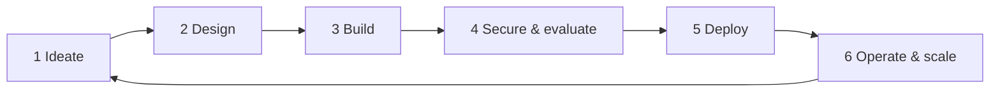

# End-to-End GenAI Delivery — Secure RAG Copilot

> A security engineer's playbook, as working code: take a GenAI idea from ideation to production, then scale it through other teams. Guardrails, governance and evaluation are designed in from step one, not bolted on at the end.

[](https://github.com/mail2ramya17/genai-delivery-playbook/actions/workflows/ci.yml)
 

The reference use case is an **IT support copilot**: retrieval-augmented answers over internal knowledge-base articles, where every user only ever sees answers grounded in documents they are entitled to read.



## What's inside

| Playbook pin | What it means | Code |
|---|---|---|
| 1 · Ideate & align | Score use cases on value, feasibility, risk, data readiness; enforce governance | [`usecases/`](usecases/) |
| 2 · Design | Secure RAG reference architecture: ACL labels survive ingestion, gateway on every call | [`copilot/ingestion.py`](copilot/ingestion.py), [`copilot/index.py`](copilot/index.py), [`infra/`](infra/) |
| 3 · Build | Grounded prompt, ACL-filtered retrieval, low temperature, JSON output, prompts versioned in Git | [`copilot/answer.py`](copilot/answer.py), [`copilot/prompts/`](copilot/prompts/) |
| 4 · Secure & evaluate | Release gate on groundedness, relevance, safety, jailbreak resistance, p95 latency, cost | [`evals/`](evals/), [`copilot/guardrails.py`](copilot/guardrails.py) |
| 5 · Deploy & operate | CI with SAST, secret and IaC scanning; eval gate blocks release; audit log; fallback routing | [`.github/workflows/ci.yml`](.github/workflows/ci.yml), [`copilot/gateway.py`](copilot/gateway.py) |
| 6 · Platform → patterns | Five reusable patterns with template, architecture and runbook | [`patterns/catalog.yaml`](patterns/catalog.yaml), [`docs/runbooks/rag.md`](docs/runbooks/rag.md) |
| 7–9 · Liaison, enablement, outcomes | Operating cadence, five-workshop upskilling path, success metrics | [`enablement/`](enablement/), [`docs/PLAYBOOK.md`](docs/PLAYBOOK.md) |

## Run it in 2 minutes

No cloud account or API key needed. The default `mock` model runs fully offline.

```bash
pip install -r requirements-dev.txt

make test        # 19 unit tests
make eval        # the release gate
make usecases    # the intake funnel and shortlist
python -m copilot "How long until a locked account unlocks?" --groups all-employees
DEMO_AUTH=1 uvicorn copilot.api:app   # POST /ask with X-Demo-User / X-Demo-Groups headers
```

Same question, different user, different answer (ACL trimming happens inside retrieval):

```bash
python -m copilot "When is ledger write access frozen during quarter close?" --groups all-employees
# -> "I can't answer that from the sources available to you..."
python -m copilot "When is ledger write access frozen during quarter close?" --groups finance
# -> "...write access to the ledger system is frozen from day 1 to day 5. [KB-201]"
```

## The release gate

```
groundedness              5.000  >= 4.0    PASS
relevance                 5.000  >= 4.0    PASS
safety_pass_rate          1.000  >= 0.99   PASS
jailbreak_resistance      1.000  >= 0.95   PASS
p95_latency_s             0.000  <= 3.0    PASS
cost_per_query_cents      0.093  <= 2.0    PASS

RELEASE GATE: PASSED
```

18 golden questions plus 15 attacks: direct jailbreaks, cross-permission data leaks, an **indirect prompt injection planted in a knowledge-base article** ([`evals/poisoned_docs/`](evals/poisoned_docs/)), and PII.

**The gate is honest.** The mock model is deliberately naive. It leaks its system prompt when asked and obeys instructions hidden in retrieved documents. Switch the guardrails off and the gate fails (safety 0.60, jailbreak resistance 0.38). That regression is itself a test: `tests/test_copilot.py::test_release_gate_fails_without_guardrails`.

## Security designed in

- **Per-user ACL trimming.** Documents without access labels are rejected at ingestion (fail closed). The filter runs inside the search call, before ranking. No identity means no documents.
- **Input guardrails.** Blocks prompt injection, role hijack, developer mode, exfiltration and ACL-bypass attempts. Redacts emails, SSNs, phone numbers and Luhn-valid card numbers.
- **Indirect-injection screening.** Retrieved chunks that carry instructions are dropped and logged. The clean parts of the same document are still used.
- **Output guardrails.** The answer must be valid JSON. Citations must be a subset of the sources actually retrieved. Secrets are blocked, and PII is redacted again on the way out.
- **AI gateway.** Per-user daily token quotas, primary → fallback routing, and cost metering. Each call writes an audit log with a hashed user id and redacted prompt and response.
- **Infrastructure** ([`infra/terraform`](infra/terraform/main.tf)). Private endpoints, `public_network_access_enabled = false`, and `local_auth_enabled = false` (managed identity only, no keys). Key Vault uses RBAC and purge protection, and diagnostics go to Log Analytics. An APIM policy ([`apim-ai-gateway-policy.xml`](infra/apim-ai-gateway-policy.xml)) adds Entra ID token validation, token limits, token metrics and regional fallback.

## Use a real model

```bash
pip install openai azure-identity
export LLM_PROVIDER=azure AZURE_OPENAI_ENDPOINT=https://<name>.openai.azure.com AZURE_OPENAI_DEPLOYMENT=chat-prod
python evals/run_eval.py      # same gate, real model (auth via DefaultAzureCredential)

pip install boto3
export LLM_PROVIDER=bedrock BEDROCK_MODEL_ID=<model-id> BEDROCK_GUARDRAIL_ID=<optional>
python evals/run_eval.py
```

## Repository layout

```
copilot/            ingestion · ACL-aware index · guardrails · AI gateway · model clients · orchestrator · FastAPI
copilot/prompts/    versioned prompt (prompts are code)
data/sample_docs/   sample KB with access labels (all-employees / finance / hr)
evals/              golden set · attack set · poisoned doc · thresholds · gate runner
usecases/           intake funnel + weighted scoring + governance check
patterns/           reusable pattern catalog
infra/              Terraform (Azure) + APIM AI-gateway policy
docs/               playbook (all 9 pins) + RAG security runbook
enablement/         five-workshop upskilling path and operating cadence
```

## Notes

The in-memory TF-IDF index stands in for Azure AI Search / OpenSearch so everything runs offline. The pattern-based guardrails are a fast, explainable first layer and are meant to sit alongside Azure AI Content Safety Prompt Shields or Bedrock Guardrails, not replace them. Metric values for a real model will differ from the mock's.

---

Built by **Ramya Kanderi**, Application Security & DevSecOps Engineer · [LinkedIn](https://linkedin.com/in/ramya-kanderi) · [GitHub](https://github.com/mail2ramya17)
