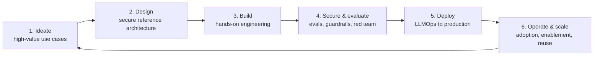
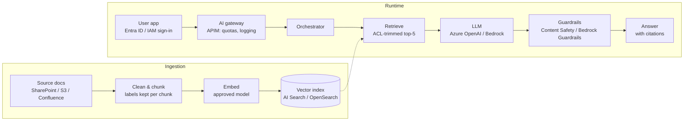

# End-to-End GenAI Delivery: a security engineer's playbook

One loop from idea to production, with security in every phase.
**Security is not a phase. It is a property of every phase.**

---

## Pin 1 - Ideate & align
Not every idea should become a GenAI project. Score the shortlist on value, feasibility, risk and data readiness, and check each candidate against enterprise AI strategy and governance before any engineering time is spent.

Funnel: ideas submitted → pass the value screen → pass feasibility & data readiness → approved, aligned and funded.
Governance controls: enterprise AI strategy, Responsible AI standard, data classification, approved model list, privacy & legal review, model risk management.

**In this repo:** `usecases/score_usecases.py`, `usecases/candidates.yaml`

## Pin 2 - Design
Design on the enterprise platform (Azure AI or AWS Bedrock), not around it. Documents keep their access labels through ingestion, so retrieval only returns what that user may see. Every call goes through a gateway and guardrails.

Security designed in: private endpoints, managed identity (no keys), Key Vault / Secrets Manager, per-user ACL trimming, PII redaction, prompt & response audit logs, token quotas, data residency.

**In this repo:** `copilot/ingestion.py`, `copilot/index.py`, `copilot/gateway.py`, `infra/`

## Pin 3 - Build
Hands-on delivery means writing the code yourself: strict grounding and citations in the prompt, a retrieval filter built from the user's own access rights, low temperature and structured output. Every prompt lives in Git like any other code.

**In this repo:** `copilot/answer.py`, `copilot/prompts/answer_v1.yaml`, `copilot/llm.py`

## Pin 4 - Secure & evaluate
Quality and safety are measured, not assumed. An automated evaluation set checks groundedness, relevance, safety, jailbreak resistance, latency and cost against agreed thresholds, and the release gate only opens when all of them pass.

Tooling in the enterprise: Azure AI Foundry evaluations, Bedrock model evaluation, promptfoo, RAGAS, PyRIT, Content Safety, Bedrock Guardrails.
Checked by hand: prompt injection via documents, data leaks across user permissions, over-privileged tools or agents, logging and retention of prompts.

**In this repo:** `evals/run_eval.py`, `evals/thresholds.yaml`, `evals/golden.jsonl`, `evals/attacks.jsonl`. The mock model deliberately obeys injected instructions, so the gate passes only because the guardrails work (see `tests/test_copilot.py::test_release_gate_fails_without_guardrails`).

## Pin 5 - Deploy & operate (LLMOps)
Production is where the real work starts. Versions are pinned, traffic goes through the AI gateway, and quality, safety and cost are watched every day. User feedback flows straight back into the evaluation set.

Dev (sandbox) → Test (eval gate + UAT) → Prod (blue/green rollout).
Practices: prompt & model versions pinned and tracked; gateway token quotas, routing and fallbacks; tracing with App Insights / CloudWatch; cost dashboards per use case and team; user feedback loop into evals; incident runbook for harmful or wrong output.

**In this repo:** `.github/workflows/ci.yml`, `Dockerfile`, audit log in `copilot/gateway.py`, `docs/runbooks/rag.md`

## Pin 6 - Platform → patterns
Teams don't need a list of platform features; they need a pattern they can copy. Package the capabilities into five reusable patterns, each with a template repo, a reference architecture and a security runbook.

**In this repo:** `patterns/catalog.yaml`

## Pin 7 - Liaison
The liaison role is translation in both directions. Platform capabilities and standards flow out to business-aligned teams (Finance IT, Supply chain IT, HR & corporate IT) as patterns; their real needs, blockers and feedback flow back to shape the platform roadmap.

## Pin 8 - Enablement & upskilling
The goal is teams that no longer need you. A five-step path from prompt engineering to agents, delivered as workshops and backed by docs, playbooks, quick-start guides and template repos.

**In this repo:** `enablement/upskilling-path.md`

## Pin 9 - Outcomes
Success is measured in business terms: use cases running safely in production, faster prototypes, patterns reused instead of rebuilt, and engineers who can now deliver GenAI on their own.

Track: use cases in production · time to first prototype · % of new builds reusing a pattern · engineers trained.
